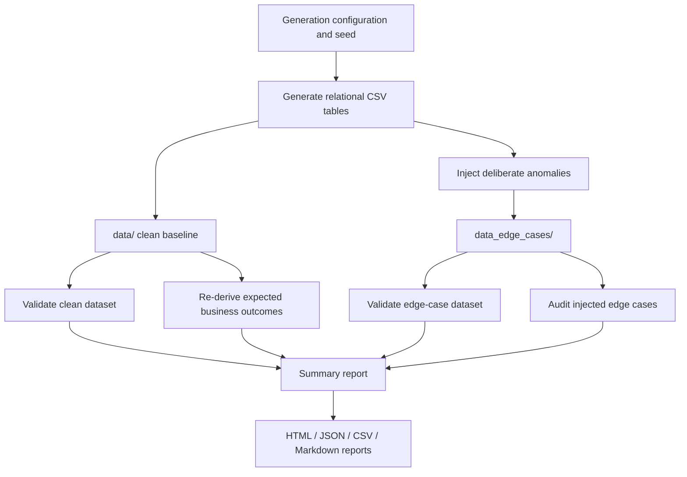
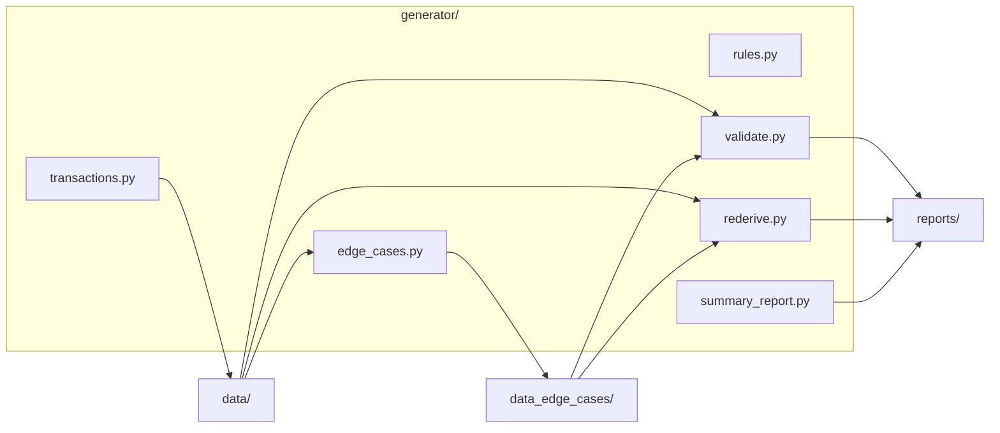
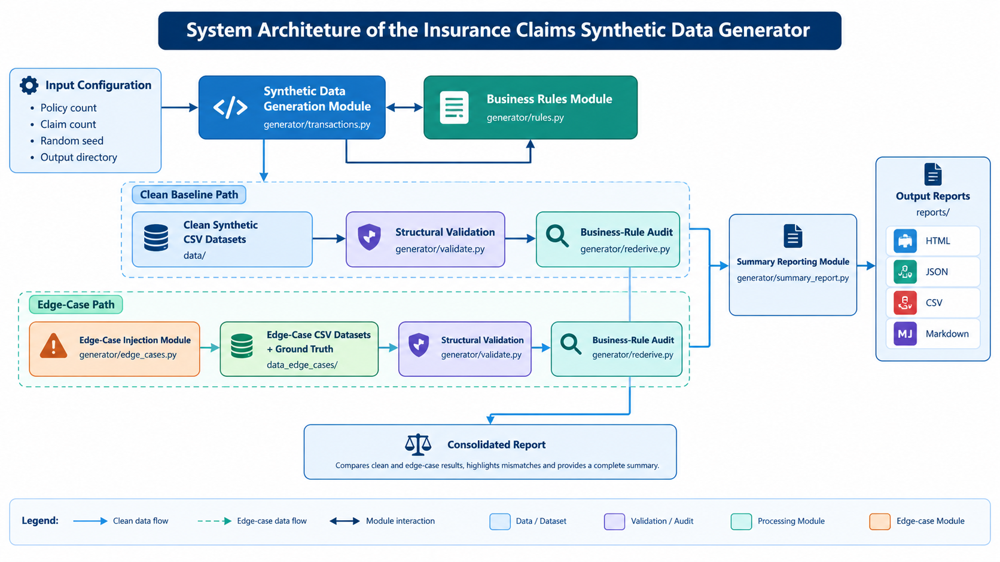
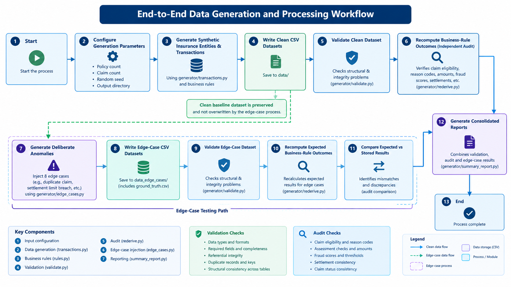
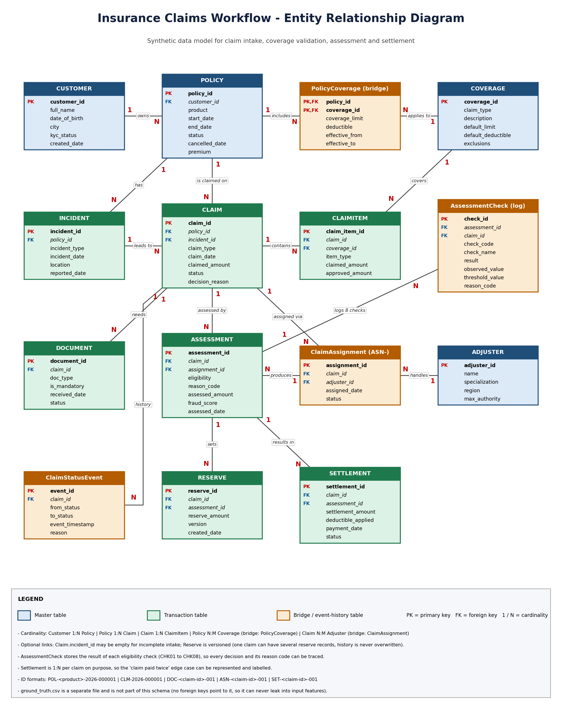
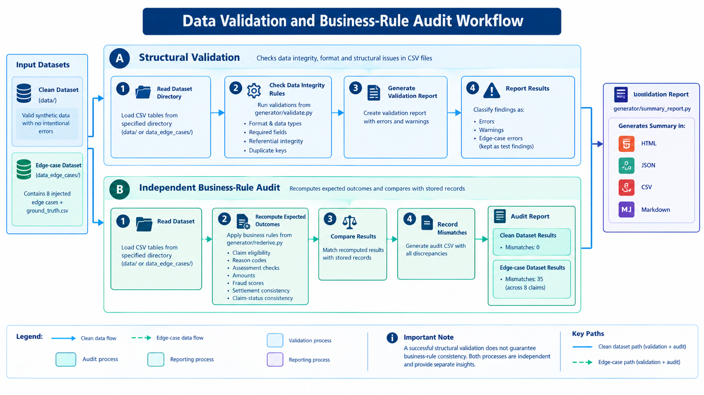
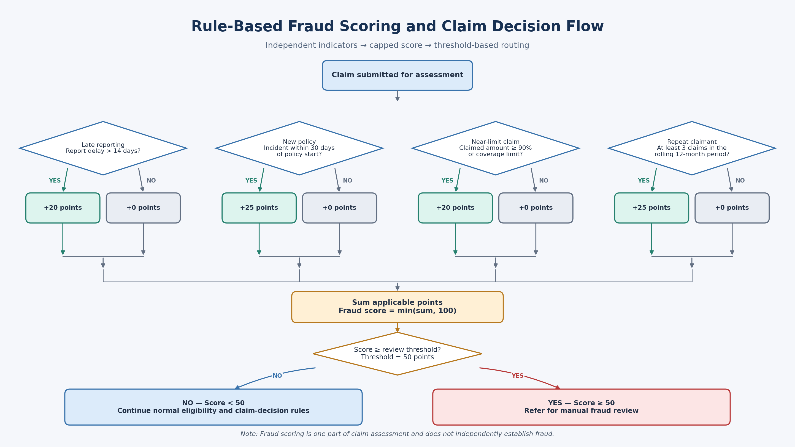

<div align="center">

# 🛡️ Insurance Claims Synthetic Data Generator

### A reproducible, rule-driven synthetic insurance claims data platform for testing validation, business logic, auditability, and fraud-review workflows.

<p>
  <strong>Deterministic Data Generation</strong> ·
  <strong>15 Relational CSV Tables</strong> ·
  <strong>Business-Rule Validation</strong> ·
  <strong>Audit & Edge-Case Testing</strong>
</p>

### 🌐 [View Live Summary Report](https://insurance-claims-synthetic-data-generator.onrender.com)

</div>
---

## 📌 Project Overview

The **Insurance Claims Synthetic Data Generator** creates realistic, relational insurance data for exploring how an insurance claims workflow can be tested without relying on real customer information.

The project generates a clean baseline dataset and a separate edge-case dataset containing deliberately injected anomalies. It then validates the datasets, independently re-derives expected business outcomes, compares those outcomes with the generated records, and produces readable audit summaries.

The goal is not only to generate CSV files. It is to make the data **traceable, reproducible, explainable, and testable**—from policy and incident records through claim decisions, assessments, reserves, settlements, and status history.


### Why this project matters

- **Privacy-conscious testing:** uses synthetic records rather than production customer data.
- **Reproducibility:** a fixed random seed makes dataset generation repeatable.
- **Relational consistency:** generates multiple connected tables with identifiers and relationships.
- **Business-rule coverage:** checks eligibility, claim limits, mandatory evidence, settlement integrity, and fraud indicators.
- **Negative testing:** introduces known edge cases so validation and audit logic can be exercised.
- **Reviewable outputs:** writes CSV, JSON, Markdown, and HTML reports for inspection.

> **Important:** The clean dataset is the baseline. The anomalies in `data_edge_cases/` are intentionally injected for testing and should not be treated as clean production data.

---

## ✨ Key Features

| Capability | What it does |
|---|---|
| Synthetic data generation | Creates interconnected insurance entities and claim lifecycle records |
| Reproducible runs | Supports a fixed seed for repeatable output |
| Dataset validation | Checks data quality and reports errors and warnings |
| Independent re-derivation | Recalculates expected outcomes and compares them with stored values |
| Edge-case injection | Adds controlled anomalies to test detection logic |
| Fraud indicators | Applies configurable rule-based scoring to selected claim characteristics |
| Summary reporting | Consolidates validation and audit outcomes into human-readable reports |
| Documentation | Includes business rules, data dictionary, ER diagram, prompts, and project reports |

---

## 🧭 Project Workflow



---

## 🧱 Architecture at a Glance



The generator modules implement the pipeline, while the documentation under `docs/` explains the data model and business rules. Files under `prompts/` capture the prompts used during project design or development, where applicable.

---

## 🗂️ Repository Structure

```text
insurance-claims-synthetic-data-generator/
├── generator/                  # Python package for generation, validation and audits
│   ├── transactions.py         # Main dataset-generation entry point
│   ├── rules.py                # Central business rules and fraud scoring
│   ├── validate.py             # Data-quality and integrity validation
│   ├── rederive.py             # Independent re-derivation / audit checks
│   ├── edge_cases.py           # Injects controlled test anomalies
│   └── summary_report.py       # Consolidated summary report generation
├── data/                       # Clean baseline CSV dataset and clean reports
├── data_edge_cases/            # Intentionally corrupted test dataset and reports
│   └── ground_truth.csv        # Registry of injected edge cases
├── docs/
│   ├── business_rules.md       # Business logic and rule definitions
│   ├── data_dictionary.md      # Table and field descriptions
│   ├── er_diagram.png          # Existing entity-relationship diagram (if present)
│   └── diagrams/               # Optional README diagrams (if created)
├── prompts/                    # Project prompts and development notes (if present)
├── reports/                    # Consolidated HTML, JSON, CSV and Markdown summaries
├── tests/                      # Automated tests (if present)
├── requirements.txt            # Python dependencies
├── .gitignore
└── README.md
```

> This is a documentation-oriented tree showing the expected main files. If your local repository uses additional filenames or slightly different paths, keep the actual filenames in sync with this section.

---

## 🧾 Data Model: 15 Relational Tables

The generated dataset contains **15 CSV tables** representing the major entities in an insurance claims workflow.

| Table | Purpose |
|---|---|
| `customer` | Synthetic customer details |
| `coverage` | Coverage definitions and limits |
| `policy` | Policy terms, dates, and status |
| `policy_coverage` | Coverage selections associated with policies |
| `adjuster` | Claims adjuster records |
| `incident` | Reported loss or incident information |
| `claim` | Claim details, amounts, and decision fields |
| `claim_item` | Items or components associated with a claim |
| `document` | Evidence and documents submitted for a claim |
| `claim_assignment` | Assignment of claims to adjusters |
| `assessment` | Claim assessment results |
| `assessment_check` | Individual checks recorded during assessment |
| `reserve` | Financial reserves associated with claims |
| `settlement` | Settlement and payment records |
| `claim_status_event` | Claim status-change history |

For exact columns, field meanings, identifiers, and relationships, see **[`docs/data_dictionary.md`](docs/data_dictionary.md)** and **[`docs/er_diagram.png`](docs/er_diagram.png)** (if the diagram exists).

---

## ⚖️ Business Logic

The business rules are centralized in `generator/rules.py`; the accompanying explanation should be maintained in [`docs/business_rules.md`](docs/business_rules.md).

### Claim eligibility and assessment

The workflow checks relevant policy and claim conditions, such as:

- Whether the incident falls within the policy's effective period.
- Whether a policy was cancelled before the incident.
- Whether the claim is a duplicate.
- Whether mandatory evidence is present and sufficiently complete.
- Whether the proposed settlement respects applicable coverage limits.
- Whether a claim requires manual review instead of automatic approval.

A failed eligibility rule may make a claim non-payable. Downstream assessments and settlement records should be interpreted in the context of the applicable decision rules.

### Rule-based fraud scoring

The current configured fraud indicators are:

| Indicator | Trigger | Points |
|---|---|---:|
| Late reporting | Report delay is greater than 14 days | +20 |
| New policy | Incident occurs within 30 days of policy start | +25 |
| Near coverage limit | Claim amount is at least 90% of the applicable limit | +20 |
| Repeat claimant | At least 3 claims in the rolling 12-month window | +25 |

The score is capped at **100**. The configured threshold for manual fraud review is **50**.

The rule implementation is in `generator/rules.py`. Check that file for the exact constants and implementation used by the current version; the documentation and code should be kept aligned.

### Rule outcomes and auditability

The re-derivation process independently checks selected stored values against expected business outcomes. Differences are written as audit mismatches rather than silently overwriting the source records. This makes the audit output useful for investigating how an injected anomaly affects eligibility, assessment, settlement, fraud scoring, or status history.

---

## 🧪 Edge Cases and Ground Truth

The `data_edge_cases/` dataset is a separate test fixture with known anomalies. The expected injected cases are recorded in [`data_edge_cases/ground_truth.csv`](data_edge_cases/ground_truth.csv).

| ID | Scenario | Main record type |
|---|---|---|
| `EDGE-001` | Claim date before policy start | Claim |
| `EDGE-002` | Policy cancelled before incident | Policy |
| `EDGE-003` | Duplicate claim | Incident / claim linkage |
| `EDGE-004` | Settlement exceeds coverage limit | Settlement |
| `EDGE-005` | Missing mandatory document | Document |
| `EDGE-006` | Claim paid twice | Settlement |
| `EDGE-007` | Fraud indicator / manual review scenario | Incident / claim |
| `EDGE-008` | Incomplete evidence | Document |

These cases are designed to test whether validation and audit processes detect the intended problems. A single injected anomaly can lead to multiple downstream audit mismatches—for example, an eligibility change can affect the assessment, assessment checks, and settlement expectation. Therefore, **the number of audit mismatches is not necessarily the number of injected edge cases**.

The edge-case dataset is expected to produce validation findings. Do not “fix” its deliberate anomalies when the goal is to test detection. Instead, verify that the findings correspond to the documented ground truth.

---

## 🚀 Getting Started

### 1. Requirements

- Python 3.10 or newer is recommended (use the version supported by your environment).
- `pip`
- A terminal such as PowerShell, Command Prompt, or a Unix shell.

### 2. Clone or open the project

If the repository is already on your machine, open a terminal in the project root.

Otherwise, clone your repository:

```bash
git clone <YOUR_REPOSITORY_URL>
cd insurance-claims-synthetic-data-generator
```

Replace `<YOUR_REPOSITORY_URL>` with the actual repository URL.

### 3. Create and activate a virtual environment

**Windows PowerShell**
```powershell
python -m venv .venv
.\.venv\Scripts\Activate.ps1
```

If PowerShell blocks activation, you can use the environment's Python directly:

```powershell
.\.venv\Scripts\python.exe -m pip install -r requirements.txt
```

**macOS / Linux**
```bash
python3 -m venv .venv
source .venv/bin/activate
```

### 4. Install dependencies

```bash
python -m pip install --upgrade pip
pip install -r requirements.txt
```

---

## ▶️ Run the Pipeline

Run commands from the repository root so that the `generator` package and relative paths resolve correctly.

### Step 1 — Generate the clean baseline

```powershell
python -m generator.transactions --policies 2000 --claims 1000 --seed 20261022 --out data
```

This generates the clean synthetic dataset under `data/`. Keep this directory as the baseline for validation and comparison.

### Step 2 — Validate the clean dataset

```powershell
python -m generator.validate --data data --report data/validation_report.csv
```

This writes a validation report. The clean baseline is expected to pass without errors or warnings for the current tested configuration.

### Step 3 — Audit / re-derive business outcomes

```powershell
python -m generator.rederive --data data --report data/clean_audit.csv
```

This independently checks generated outcomes and writes audit mismatches. The current tested clean baseline produced **0 mismatches across 1,000 claims**.

### Step 4 — Generate or refresh edge-case data

Run the edge-case injection command supported by your current implementation. For example, if the module exposes a command-line entry point:

```powershell
python -m generator.edge_cases --data data --out data_edge_cases
```

**Check `python -m generator.edge_cases --help` first.** If the module does not expose this exact interface, use the command documented in that module or its source file. Do not overwrite the clean `data/` baseline with edge-case data.

### Step 5 — Validate the edge-case dataset

```powershell
python -m generator.validate --data data_edge_cases --report data_edge_cases/validation_report.csv
```

This dataset is intentionally corrupted. In the current tested run, validation detected three expected errors: two duplicate-claim-key findings and one multiple-settlement finding.

### Step 6 — Audit the edge cases

```powershell
python -m generator.rederive --data data_edge_cases --report data_edge_cases/audit_mismatches.csv
```

The current tested run produced **35 audit mismatches across 8 injected edge cases**. These include cascading downstream differences, not 35 independent injected cases.

### Step 7 — Build the consolidated summary

```powershell
python -m generator.summary_report --data data --edge-data data_edge_cases --out reports --audit-report data/clean_audit.csv --edge-audit-report data_edge_cases/audit_mismatches.csv --validation-report data/validation_report.csv --edge-validation-report data_edge_cases/validation_report.csv
```

The summary command creates:

- `reports/summary_report.html`
- `reports/summary_report.json`
- `reports/summary_report.csv`
- `reports/summary_report.md`

Explicitly providing separate clean and edge-case report paths prevents one validation run from accidentally replacing the other's report.

---

## 📊 Current Verification Snapshot

The following results reflect a recorded test run of this project configuration. Regenerate the datasets and reports to confirm them after changing code, seed values, or rules.

| Check | Clean baseline | Edge-case dataset |
|---|---:|---:|
| CSV tables | 15 | 15 |
| Claims audited | 1,000 | 1,000 |
| Validation errors | 0 | 3 expected findings |
| Validation warnings | 0 | Check latest report |
| Audit mismatches | 0 | 35 |
| Injected scenarios | — | 8 |

**Interpretation:** The clean baseline passed validation and re-derivation in the recorded run. The edge-case dataset produced the documented intentional findings. Always use the generated reports as the source of truth for the latest run rather than relying on static counts in this README.

---

## 📈 Reports and Outputs

After running the pipeline, review:

| File | What to look for |
|---|---|
| `reports/summary_report.html` | Human-readable consolidated report |
| `reports/summary_report.md` | Markdown summary suitable for GitHub |
| `reports/summary_report.json` | Structured output for programmatic use |
| `reports/summary_report.csv` | Tabular summary |
| `data/validation_report.csv` | Clean data-quality findings |
| `data/clean_audit.csv` | Clean baseline re-derivation results |
| `data_edge_cases/validation_report.csv` | Expected edge-case validation findings |
| `data_edge_cases/audit_mismatches.csv` | Audit differences triggered by edge cases |
| `data_edge_cases/ground_truth.csv` | Expected injected anomalies |

---

## 📚 Business Logic, Data Dictionary, and Prompts

These files are the best starting points for reviewers who want to understand not only how to run the project, but why the rules exist and how the system was designed.

| Resource | Path | Why to read it |
|---|---|---|
| Business rules | [`docs/business_rules.md`](docs/business_rules.md) | Eligibility, validation, settlement and fraud logic |
| Data dictionary | [`docs/data_dictionary.md`](docs/data_dictionary.md) | Table definitions, fields, keys and data meanings |
| ER diagram | [`docs/er_diagram.png`](docs/er_diagram.png) | Visual overview of table relationships, if present |
| Project prompts | [`prompts/`](prompts/) | Prompt files used for planning, implementation or documentation, if present |
| Edge-case ground truth | [`data_edge_cases/ground_truth.csv`](data_edge_cases/ground_truth.csv) | Expected scenarios and injected anomaly locations |
| Rule implementation | [`generator/rules.py`](generator/rules.py) | Exact thresholds and decision logic |
| Validation implementation | [`generator/validate.py`](generator/validate.py) | Integrity and data-quality checks |
| Audit implementation | [`generator/rederive.py`](generator/rederive.py) | Independent expected-outcome calculations |
| Generation implementation | [`generator/transactions.py`](generator/transactions.py) | Main data-generation entry point |
| Edge-case implementation | [`generator/edge_cases.py`](generator/edge_cases.py) | Controlled anomaly injection |
| Summary implementation | [`generator/summary_report.py`](generator/summary_report.py) | Report aggregation and output generation |

> **Prompt directory note:** Keep prompt files under `prompts/` with descriptive names, such as `data_model_design.md`, `business_rules_design.md`, `edge_case_design.md`, and `readme_diagrams.md`. Only list or link files that actually exist in your repository; remove or update any illustrative names that are not present.

---

## 🖼️ Diagrams

If the corresponding image files exist, embed them in this section to help readers understand the project quickly.

### System Architecture



### End-to-End Data Processing Workflow



### Insurance Claims Entity-Relationship Diagram



### Validation and Audit Workflow



### Fraud Scoring and Claim Decision Flow



If a diagram has not been generated yet, its image may not render on GitHub. Add the actual image at the referenced path or remove that image link until it is available. Keep diagrams consistent with the current code and rules.

---

## 🧪 Testing

If automated tests are present in `tests/`, run them with the test runner configured by the project. For a `pytest` setup:

```bash
python -m pytest -q
```

If `pytest` is not installed or no tests are currently configured, inspect `requirements.txt` and `tests/` before assuming this command is available.

For a basic end-to-end verification, run the clean validation and audit commands, then the edge-case validation and audit commands, and finally the summary report command shown above.

---

## 🔍 Design Principles

1. **Keep clean and corrupted data separate.** The clean baseline is for normal downstream use; the edge-case dataset is for negative testing.
2. **Make decisions explainable.** Business rules are explicit and centralized rather than hidden in scattered code.
3. **Preserve traceability.** Ground-truth records and audit reports help connect findings to known injected anomalies.
4. **Prefer repeatable experiments.** Record the seed, command, and rule configuration when comparing runs.
5. **Report rather than silently repair.** Validation and re-derivation surface issues so a reviewer can inspect them.
6. **Keep documentation aligned with code.** Update the business-rule document and README when thresholds or behavior change.

---

## 🔐 Data and Responsible Use

This project is designed for synthetic-data development, demonstrations, learning, and test automation. Do not add real personal, financial, medical, or insurance-customer data to the repository. Before publishing, review the generated files and repository history to ensure no sensitive data or secrets are included.

Synthetic records are useful for testing, but they do not automatically represent the distribution, legal requirements, or operational behavior of a real insurer's production portfolio.

---

## 🛠️ Troubleshooting

### `ModuleNotFoundError: No module named 'generator'`

Run the command from the repository root and confirm that the virtual environment is active.

### Clean validation unexpectedly fails

- Inspect `data/validation_report.csv`.
- Regenerate the clean dataset with the intended seed.
- Check whether a prior edge-case operation modified `data/` by mistake.
- Verify that the clean and edge-case report paths are different.

### Edge-case validation reports errors

This is expected for the deliberately corrupted dataset. Compare the findings with `data_edge_cases/ground_truth.csv` and the current validation report.

### Summary results look inconsistent

Pass the clean and edge-case report paths explicitly, as shown in Step 7. Re-run validation first, then re-derive the audit files, and then rebuild the summary.

### A diagram does not display on GitHub

Confirm that the referenced image exists at the exact path and that filename capitalization matches. GitHub paths are case-sensitive.

---

## 🗺️ Potential Next Improvements

- Add a single CLI command to run the complete pipeline end to end.
- Add automated regression tests for each documented business rule.
- Generate a machine-readable edge-case detection coverage report.
- Add schema validation and referential-integrity tests for all 15 tables.
- Add configurable scenario profiles and dataset sizes.
- Track rule versions and include configuration metadata in reports.
- Add a lightweight dashboard to explore validation findings and claim outcomes.

---

## 👩‍💻 Author / Project Notes

**Project:** Insurance Claims Synthetic Data Generator  
**Primary language:** Python  
**Output format:** CSV datasets with HTML, JSON, CSV and Markdown audit summaries

This README documents the intended workflow and the latest recorded verification snapshot. Confirm file paths and command-line options against the current repository before publishing, especially the edge-case generator interface and any optional diagrams or prompt files.

---

<div align="center">

**Built for reproducible data generation, transparent business rules, and testable claims workflows.**

</div>
